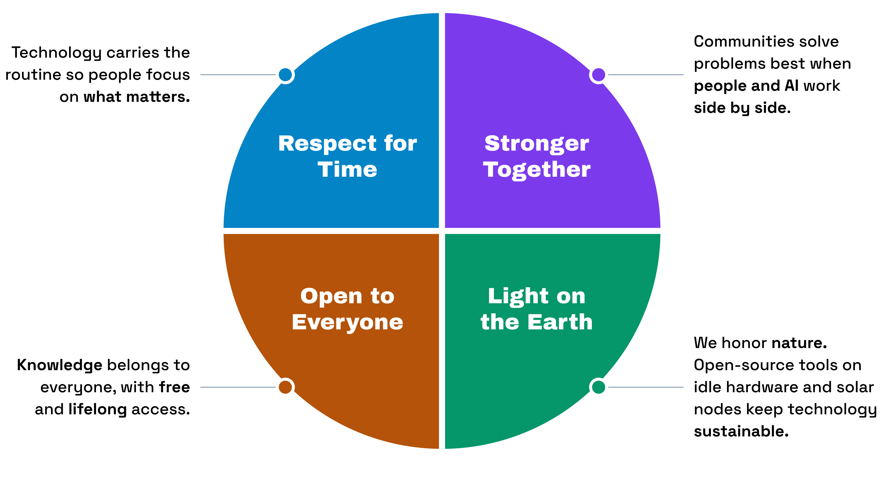
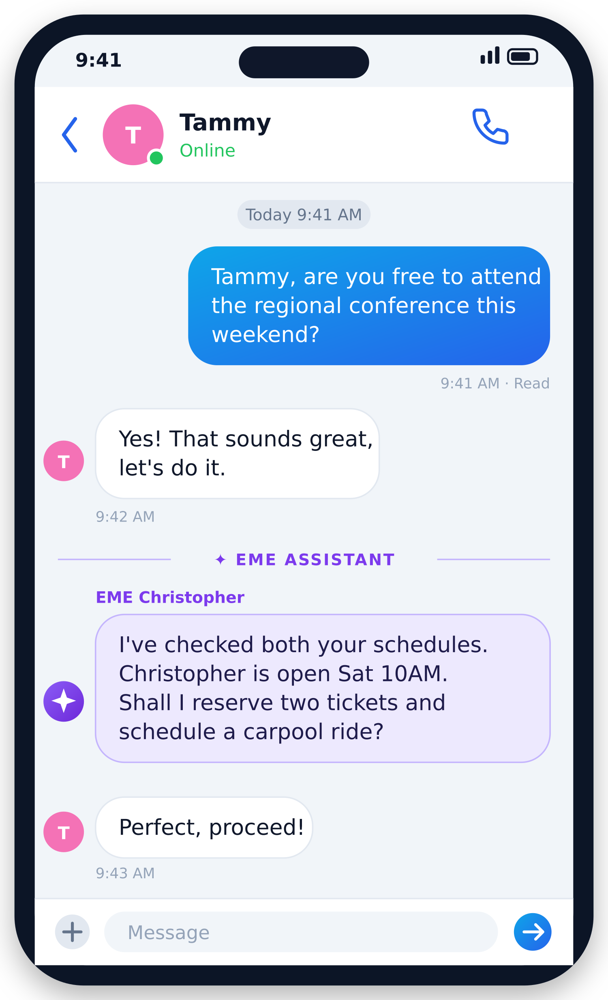
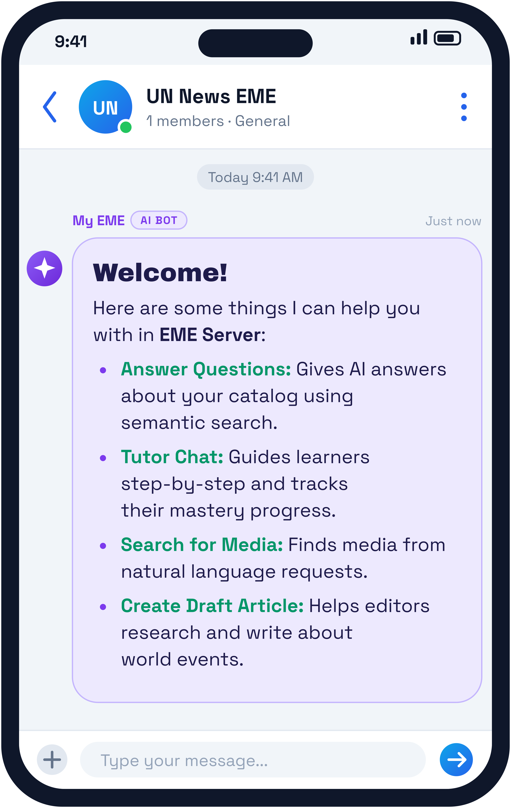
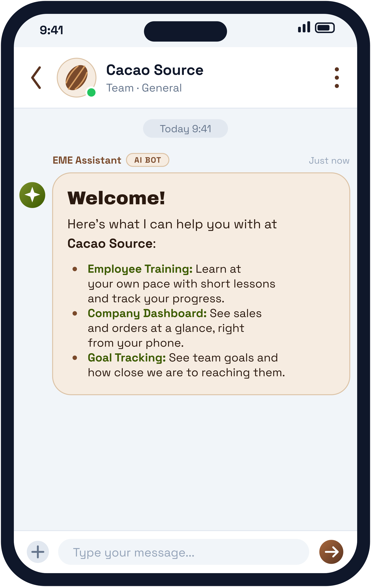
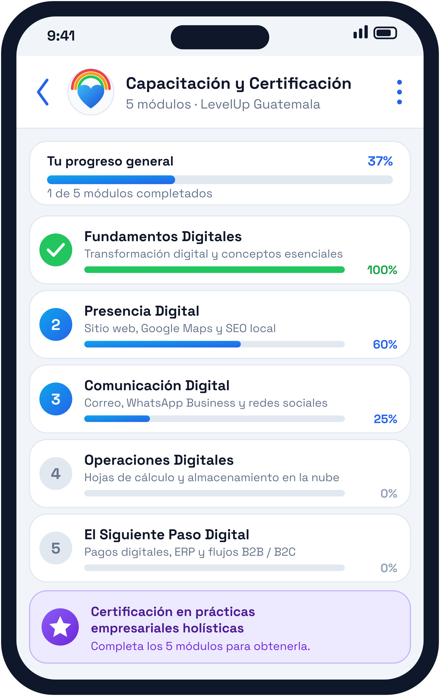

# **Collective Intelligence Harness**

*Empowered AI Vision for All*

EME is an all inclusive AI package delivered through a single, open platform. Empowering organizations to harness powerful digital capabilities while keeping humans fully in control.

EME offers a flexible AI harness that you can easily customize. Using a chat interface as the front door, it brings together document management, smart AI helpers, writing tools, translation, audio transcription, learning guides, data analysis, media storage, and database access into one simple system.

## EME Values

 Peer to Peer

## 

## ---

 **1\. Demystifying the "Electronic Me" (EME)**

At the heart of the system is the **EME (Electronic Me)** persona. It acts as an AI assistant to your team members, keeping humans in control while augmenting their capabilities. Each person trains their EME persona as a personalized digital twin that matches their communication style, schedule, and specialized knowledge, relying on human guidance for key actions.

### **People Driven: Digital Twin** 

> Users stay in full control of their EME. By adding reference files, team guidelines, and personal preferences, leaders can adjust their EME for specific needs:

> * **Clear and Precise:** Set up for accurate administrative reports, legal reviews, or technical logs.  
> * **Friendly and Helpful:** Set up for community outreach, student tutoring, or customer support.

**Omnichannel Communication**

My EME makes communication easier by connecting app users with team members who use email, helping everyone stay updated and productive in any project.  
---

**2\. A Universal Productivity Booster for Everyone**

### **Scenario A: Peer-to-Peer Logistical Help**

In a regular chat between friends, like Christopher and Tammy, they talk about attending a weekend event. When they express interest, **EME Christopher** helps right inside the conversation. The EME assistant checks their calendars, finds open times, confirms event details, and offers to handle tickets and travel plans. This keeps the plan simple without leaving the chat app.

## 

## ---

**3\. Custom EME Servers**

To support team projects, **EME** lets users build custom **EME Servers**. Built on a **100% open-source** setup, software developers, local IT teams, and community organizers can quickly build custom servers and connect them to EME World to solve specific team needs.

You can reach all server features through simple **chat screens** supported by interactive forms, clean data tables, and helpful Meetinggraphics.

EME World helps public groups and non-profits work faster using a single, secure digital system. By keeping humans in full control and letting each team member train their own EME persona as a digital twin, it boosts productivity and standardizes key actions while giving organizations complete oversight of their technology.

Here are some chat apps being created by EME users:

<table>
  <tr>
    <td align="center" width="25%"> Peer to Peer</td>
    <td align="center" width="25%"> UN News</td>
    <td align="center" width="25%"> Cacao Source</td>
    <td align="center" width="25%"> Cumbre de Cocreación</td>
  </tr>
</table>

## **5\. Complete AI Harness for Organizations and Governments**

EME World offers to serve as the unified AI harness for all AI needs across any organization or government agency. By consolidating your entire AI infrastructure into a single, secure environment, EME eliminates fragmented tooling and brings full governance, security, and operational clarity to your operations.  
Our comprehensive AI harness encompasses a complete suite of integrated features and capabilities:

* **Memory:** Context-aware persistence for seamless past-interaction retention across teams.  
* **Agents:** Autonomous and semi-autonomous digital helpers tailored to specific roles.  
* **Chat:** Intuitive conversational front doors for users, teams, and public service interactions.  
* **Automation:** Streamlined execution of repetitive administrative tasks and complex workflows.  
* **Informatics:** Advanced analytics, reporting, and business intelligence aggregation.  
* **Database:** Structured data integration, vector indexing, and relational storage access.  
* **Media Management:** Centralized asset tagging, search, and organization for digital media.  
* **Storage:** Secure, enterprise-grade storage designed for dynamic content and archives.  
* **Translation:** Multi-language real-time translation for global and multi-lingual community outreach.  
* **Transcribing & Voice to Text:** Automated audio-to-text conversion for meetings, field interviews, and accessibility.  
* **Video Editing:** Automated snippet extraction, visual asset processing, and content creation tools.  
* **Orchestration:** Multi-agent coordination and cross-system task sequencing under human supervision.
* **Open API:** Includes complete REST based API for AI needs. Compatible with OpenAI syntax and made available to EME servers but with no extra charges based on usage.  

Our deployment model offers predictable budgeting and complete sovereignty over your technological ecosystem. Delivered at a transparent flat rate, the service guarantees complete data privacy with zero corporate connections, data harvesting, or vendor lock-in. Every plan is fully managed and includes all necessary hosting, open AI models, dedicated GPU allocation, and cloud storage needs out of the box.

## **4\. Next Steps & Collaborative Onboarding**

The EME World platform provides a clear plan for leaders who want to build independent, community-focused tools powered by human-guided AI assistant personas.

> To ask about local test programs, server sponsorship, or open-source setup, contact the **EME World OSPO Team**:  
> 

> * **Official Public Portal:** [eme.world](https://www.google.com/url?source=gmail&sa=E&q=https://eme.world)  
> * **Open Source Repository:** [github.com/entermedia-community/eme-server](https://www.google.com/url?source=gmail&sa=E&q=https://github.com/entermedia-community/eme-server)  
> * President: Christopher Burkey [cburkey@eme.world](mailto:cburkey@eme.world) \+1 513 898-2063