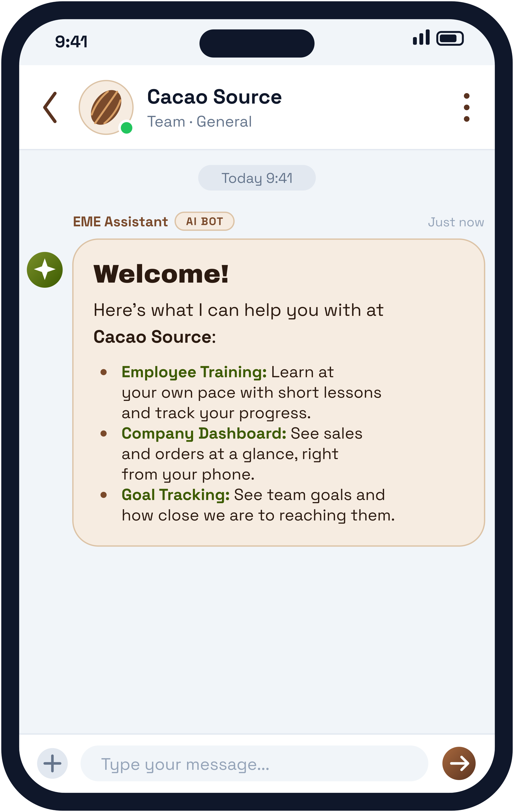
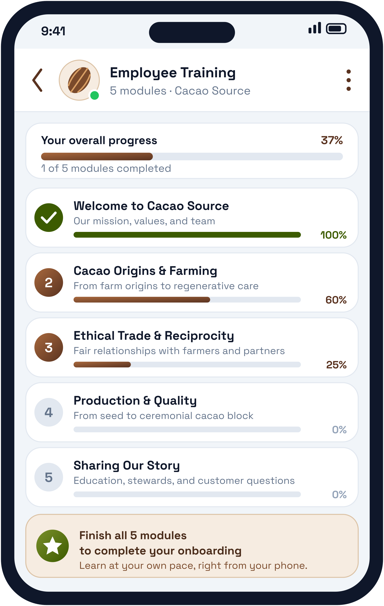

**Christopher Burkey** · Tel: +502 4611 8131 · [eme.world](https://eme.world)

# **Proposal: A Mobile App for Cacao Source**

# **Employee Training, Company Dashboard, and Goal Tracking, in One App on Every Team Member's Phone**

| Project Details | Information |
| :---- | :---- |
| **Prepared for** | Cacao Source, a Guatemalan social enterprise (San Marcos la Laguna, Sololá, Guatemala) |
| **Prepared by** | EME World Inc. (Foundation) |
| **Contact** | Christopher Burkey, +502 4611 8131 |
| **Product** | Branded mobile app built on the EME World Collective Intelligence platform |
| **Menu** | Employee Training · Company Dashboard · Goal Tracking |
| **Investment** | $150 USD per month |
| **Our Request** | Help from the Cacao Source team to test the app as it is built |

| Main menu | Employee Training |
| :---: | :---: |
|  |  |

*Sample screens. The training content and progress numbers shown are placeholders.*

# **1\. Overview**

Cacao Source describes itself as "a Guatemalan Social Enterprise producing artisanal cacao and crafting educational space." Its mission is to rebuild relationships between people, plants, and the systems that sustain life through ethical sourcing, inclusive collaboration, and regenerative ecosystems.

We propose a mobile app that brings the day-to-day work of that mission into one place. It has three menu items: **Employee Training**, **Company Dashboard**, and **Goal Tracking**. Every team member, steward, and collaborator can use it from their phone, wherever they are.

# **2\. Why Cacao Source Needs It**

Cacao Source's work is spread across people and places. According to the company's own website:

* The team is made up of members in Guatemala, Brazil, Mexico, France, and Canada, working across production, ethical trade, education, and administration.
* Cacao comes from more than nine farm origins across Guatemala, and is processed by Kaqchikel women's collectives in San Marcos la Laguna.
* An international community of stewards and ambassadors shares the cacao and the story abroad.
* The company runs trainings, an online course, and in-person programs, and in 2025 formed an Education Department.
* It publishes bi-annual impact reports and works with partners such as the Give Back to the Source NGO.

A growing, distributed team needs a shared place to learn together, see how the business is doing, and track progress toward shared goals. Today those things usually live in separate chats, documents, and spreadsheets. The app puts them in one place.

# **3\. The App**

## **Employee Training**

A home for the knowledge every team member needs, available in the pocket and at their own pace.

* Course modules for onboarding, cacao and production knowledge, ethical trade, and the company's values.
* Short lessons, quizzes, and a progress indicator for every person and every course.
* Content that Cacao Source's own educators upload and update, so the training stays theirs.
* An AI assistant that answers questions about the material in plain language.

## **Company Dashboard**

A live view of how the business is doing, on every team member's phone.

* Sales and orders at a glance, shown as simple numbers and charts.
* Recent orders and their status, so the team knows what needs attention.
* Trends over time, such as the week, the month, and the year.
* Connects to the tools Cacao Source already uses to take orders, so the numbers stay current without extra typing. (We will confirm which tools in the kickoff.)

## **Goal Tracking**

A simple way to see whether the team is moving toward what it set out to do.

* Team and company goals with owners, targets, and progress bars.
* Goals can be linked to the dashboard, so sales and order targets update automatically.
* A clear view that can support the company's regular impact reporting.

# **4\. How It Works**

The app is built on **EME World Collective Intelligence**, an open-source platform. Cacao Source keeps control of its own content and data. We set up, host, and maintain the app, and adapt it as Cacao Source learns what works.

# **5\. Investment and Partnership**

**Investment: $150 USD per month**, which covers hosting, maintenance, and support of the app for Cacao Source.

**Our request: help with testing.** The app will be better if the people who will use it help shape it. We ask Cacao Source to:

* Name a small group of team members to try the app early.
* Share feedback on what is clear, what is confusing, and what is missing.
* Help us choose the first training content and the first goals to load, and give us access to the sales and order data for the dashboard.
* Meet briefly on a regular basis during the testing period.

# **6\. Proposed Steps**

| Step | What Happens |
| :---- | :---- |
| **1\. Kickoff** | Agree on the three menu items, the first training content, and who will test. |
| **2\. First Version** | We set up the app with Cacao Source's name and branding and load the first content. |
| **3\. Testing** | The test group uses the app and gives feedback; we improve it each week. |
| **4\. Rollout** | The app opens to the whole team, with support from us. |

# **7\. Next Steps**

If this fits what Cacao Source needs, we would like to schedule a short call to confirm the scope, the testing group, and a start date.

---

**Contact:** Christopher Burkey · +502 4611 8131 · [eme.world](https://eme.world)
