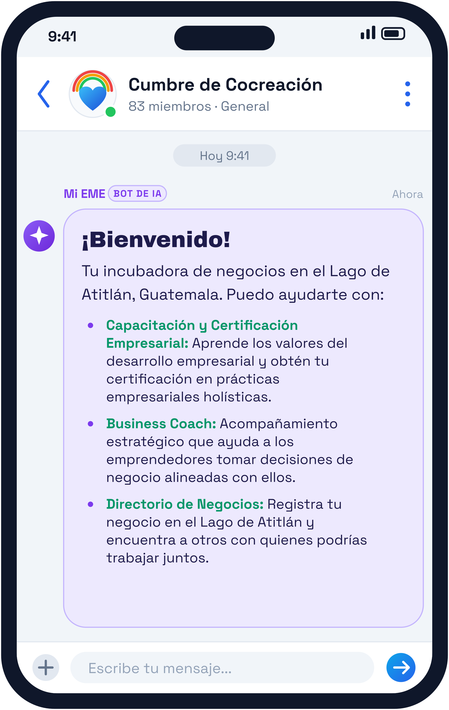
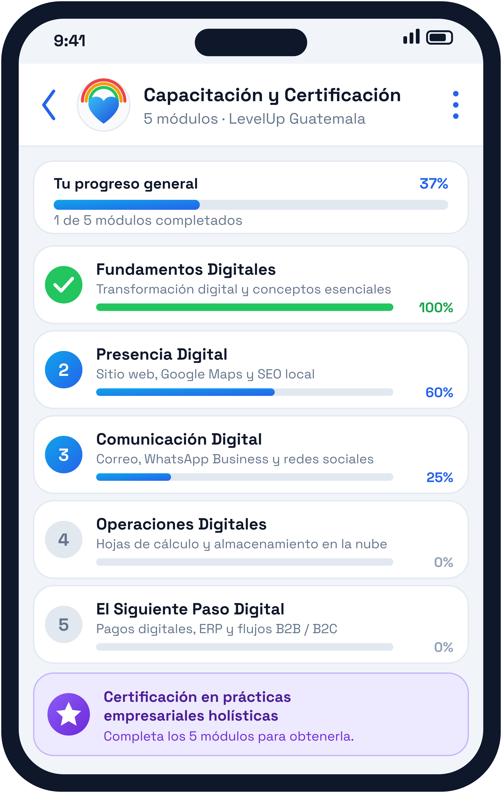
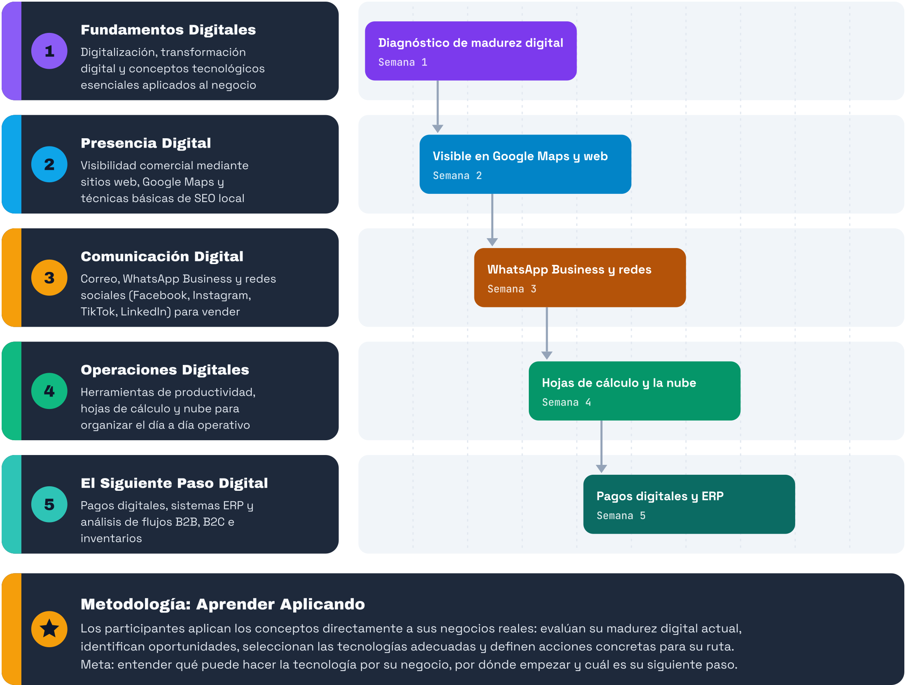

 

**Christopher Burkey** · Tel: +502 4611 8131 · [eme.world](https://eme.world)

# **Propuesta de Aplicación Móvil y Programa Vocacional: Cumbre de Cocreación**

# **Solicitud de Financiamiento (\$1,000 USD) para el Lanzamiento de la Aplicación Móvil de Capacitación para Todo Lago Atitlán**

# 

| Detalle del Proyecto | Información Institucional |
| :---- | :---- |
| **Programa** | Cumbre de Co creación (Incubadora y Capacitación Vocacional) |
| **Presentado por** | Asistente de Inteligencia Colectiva EME / EME World Inc. (Fundación) |
| **Ubicación Base** | San Marcos La Laguna, Sololá, Guatemala |
| **Público Objetivo** | Toda persona que opere un negocio en el Lago de Atitlán, sea local o extranjera. |
| **Objetivo** | Ampliar las oportunidades laborales y de networking. |
| **Entidades Aliadas** | **LevelUp Guatemala** (donante del catálogo formativo); **EME World Inc.** (ONG, fundación de tecnología que presenta la propuesta); **UN Open Source Week** de la ONU (colaboración estratégica, ver sección 6) |

| Pantalla de inicio | Módulos de capacitación |
| :---: | :---: |
| |  |

# 

|  |
| :---- |

# **1\. Visión General del Programa**

La **Cumbre de Cocreación** es una propuesta para lanzar una aplicación móvil de capacitación vocacional y desarrollo comunal dirigida a toda la población de San Marcos La Laguna y comunidades aledañas del Lago de Atitlán. Construida sobre la plataforma sin fines de lucro **EME World Collective Intelligence**, la iniciativa solicita \$1,000 USD para financiar su lanzamiento e implementación inicial.

El objetivo central es brindar herramientas prácticas de digitalización, estrategias de negocio, contabilidad básica, educación bancaria y coaching nativo en Inteligencia Artificial (IA) de código abierto. A través de esta plataforma, cada participante podrá integrar su conocimiento local dentro de un ecosistema digital inclusivo sin ceder el control o la propiedad de sus datos.

## **De Usuarios Digitales a Empresarios Digitales**

El programa busca desbloquear el potencial tecnológico de emprendedores formales e informales. En economías emergentes, miles de emprendedores ya utilizan teléfonos inteligentes, aplicaciones de mensajería y redes sociales a diario; sin embargo, muchos no han tenido la oportunidad de comprender cómo las herramientas digitales pueden mejorar sistemáticamente su forma de operar, llegar a clientes y crecer.

A través de una experiencia práctica y progresiva, los participantes descubren cómo la tecnología les ayuda a organizarse, visibilizarse, comunicarse, vender, operar eficientemente y tomar mejores decisiones para hacer crecer su negocio. La visión central es clara: **"La tecnología no debe ser una barrera para el emprendimiento, sino un multiplicador del potencial emprendedor."**

# **2\. La Necesidad: Oportunidades de Empleo en el Lago**

Las comunidades del Lago de Atitlán enfrentan una escasez crónica de oportunidades de empleo. La economía local depende en gran medida del turismo, por lo que en la temporada baja los ingresos caen y muchas familias no cuentan con fondos suficientes para cubrir su alimentación. A esto se suma que la vivienda se ha vuelto inaccesible para buena parte de los habitantes, lo que aumenta la presión sobre los hogares y limita sus posibilidades de salir adelante.

Para cambiar esta realidad no basta con esperar el regreso de la temporada alta: es necesario **capacitar a toda la comunidad para construir una economía moderna**, en la que cualquier persona pueda usar su teléfono para formar parte de la fuerza laboral digital, ofrecer sus servicios, visibilizar su negocio y llegar a nuevos clientes durante todo el año.

## **Visión a Largo Plazo**

A largo plazo, la Cumbre de Cocreación aspira a que **empresas de mayor tamaño patrocinen programas de empleo, capacitaciones y eventos** en la región, creando un puente estable entre el talento local y las oportunidades de trabajo y de negocios.

# **3\. Pilares del Programa e Incubación Nativa en IA**

El plan formativo combina el desarrollo de habilidades tradicionales de negocios con herramientas de vanguardia tecnológica adaptadas a la realidad de la región:

* **Business Coach:** Acompañamiento estratégico que ayuda a los emprendedores a determinar sus valores fundamentales para tomar decisiones de negocio alineadas con ellos.  
* **Creación de Contenido y Gestión Documental:** Un espacio dedicado para subir información y material, facilitando la generación de carteles, afiches y nuevos documentos institucionales o comerciales.
* **Directorio de Negocios:** Un espacio para registrar tu negocio en el Lago de Atitlán y encontrar a otros con quienes trabajar, facilitando el networking y la creación de alianzas entre emprendedores.

# **4\. Donación del Catálogo Formativo por LevelUp Guatemala**

Como pilar estructural de la formación vocacional, la empresa guatemalteca **LevelUp** ha donado su catálogo integral de digitalización para emprendedores. Este programa progresivo permite convertir a los usuarios digitales en empresarios digitales mediante cinco módulos clave:

**Metodología: Aprender Aplicando** Los participantes no solo aprenden sobre tecnología, sino que aplican los conceptos directamente a sus propios negocios reales. Mediante herramientas prácticas, evalúan su madurez digital actual, identifican oportunidades, seleccionan las tecnologías adecuadas y definen acciones concretas para su ruta de digitalización. El objetivo es que cada emprendedor finalice el programa entendiendo qué puede hacer la tecnología por su negocio, sabiendo por dónde empezar y teniendo claro cuál es su siguiente paso.

# **5\. Fondo de Lanzamiento (\$1,000 USD)**

Para poner en marcha la aplicación móvil Cumbre de Cocreación y ofrecer capacitación gratuita a todos los habitantes de San Marcos La Laguna, se solicita un fondo de inicialización de \$1,000 USD destinado a la infraestructura técnica y facilitación comunitaria.

* **Contratación Local:** Financiamiento destinado a patrocinar y contratar a dos empleados/participantes locales dedicados, quienes coordinarán la gestión directa y el seguimiento de las actividades formativas en San Marcos La Laguna.  
* **Capacitación Abierta y Universal:** Garantizar el acceso a la aplicación de formación y a los talleres para todos los emprendedores, jóvenes y vecinos de la comunidad local.

## **Justificación de Financiamiento: ¿Por qué financiar este programa?**

La inclusión digital no consiste únicamente en proveer acceso a la tecnología, sino en construir la capacidad para utilizarla de manera productiva. Para un emprendedor informal, un primer paso digital puede significar organizar pedidos en lugar de depender de la memoria. Para un micronegocio, puede significar volverse visible en línea. Para un emprendedor en crecimiento, puede implicar aceptar pagos digitales, analizar ventas o introducir automatizaciones.

Estos cambios fundamentales establecen las bases para una mayor productividad, empresas más sólidas y acceso a nuevos mercados, preparando a los participantes para adoptar capacidades avanzadas de datos, automatización e Inteligencia Artificial.

# **6\. Alineación Internacional: EME World Inc. y la ONU**

**EME World Inc.** es una organización sin fines de lucro 501(c)(3) dedicada a la mejora comunitaria y el desarrollo de capacidades a través de tecnologías abiertas e Inteligencia Colectiva.

Actualmente, EME World Inc. lleva a cabo iniciativas globales de recaudación de fondos y mantiene colaboraciones estratégicas en el marco de eventos como la UN Open Source Week de la Organización de las Naciones Unidas (ONU). Esta alianza busca desplegar asistentes digitales personales EME para el personal de la ONU y utilizar la tecnología como infraestructura pública para el empoderamiento de comunidades vulnerables y en desarrollo.

# **7\. Calendario de Sesiones y Próximos Pasos**

Las actividades de la Cumbre de Co creación se coordinan en modalidad híbrida para garantizar la participación presencial y remota:

* **Reuniones Semanales:** Todos los miércoles de manera presencial en San Marcos La Laguna y con conexión directa vía Zoom.  
* **Fase Actual:** Recopilación de notas, diseño de guiones instructivos e integración del catálogo formativo donado por LevelUp.

---

**Aprobaciones y Firma del Documento**

Para constancia de la presentación de esta propuesta y su sometimiento al periodo de validación comunitaria:

Representante de EME World Inc.: Christopher Burkey cburkey@eme.world

Coordinador Comunitario San Marcos La Laguna: Bracamonte de Leon growth@growtlan.com

Coordinador Level Up: Louis Prouvost <Louis@levelup.gt> www.levelup.gt

Fecha de Publicación para Consenso: Jan 1 2027