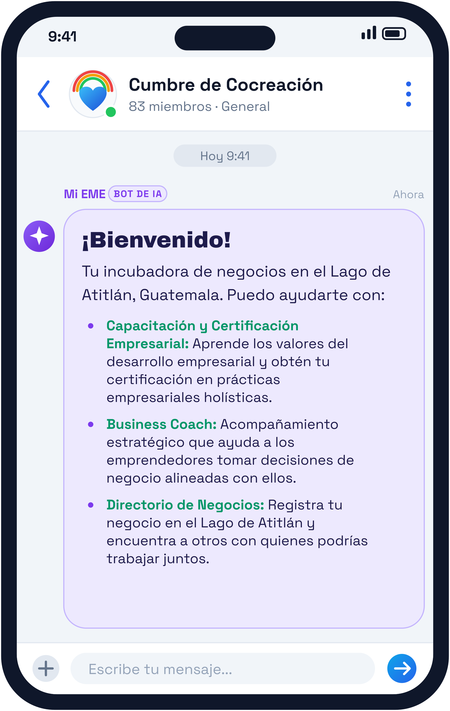
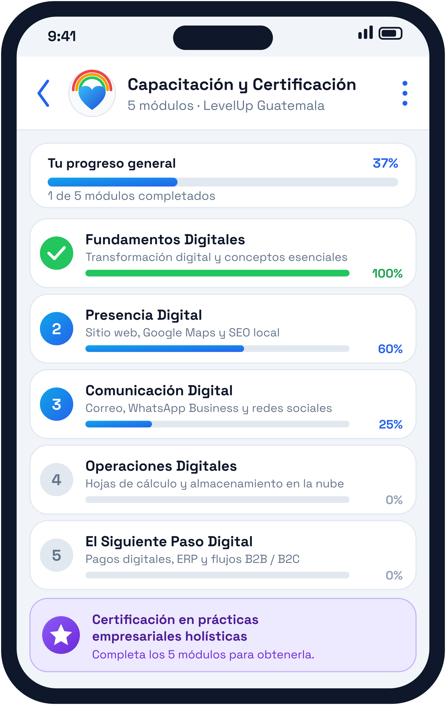
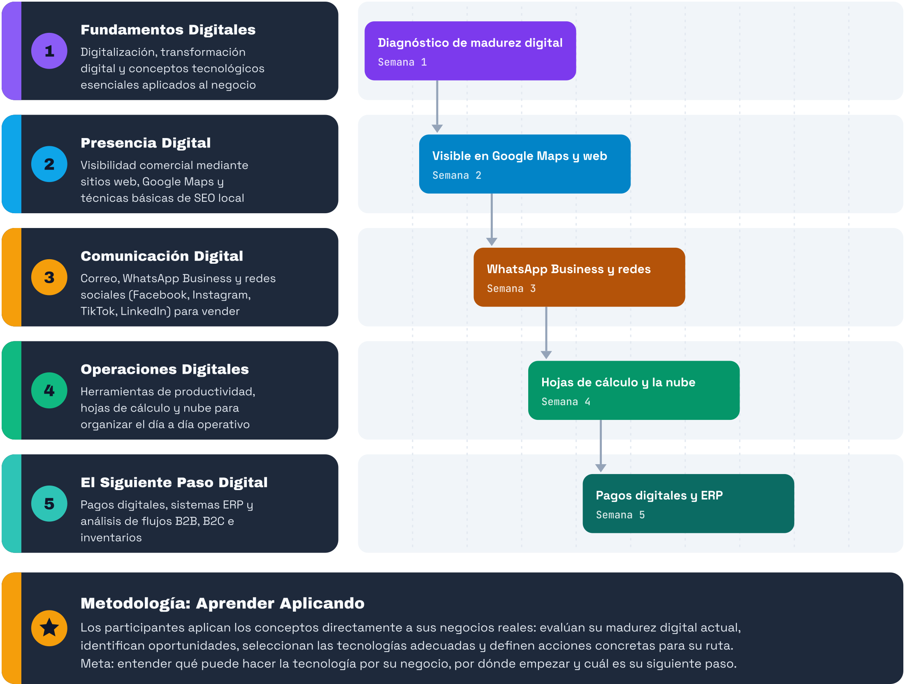
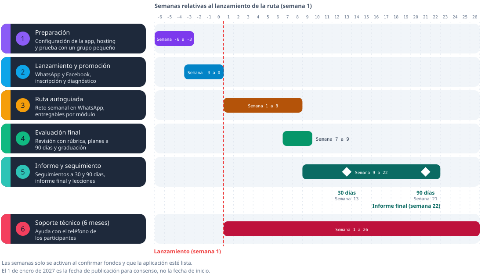

 

**Christopher Burkey** · Tel: +502 4611 8131 · [eme.world](https://eme.world)

# **Cumbre de Cocreación: capacitación gratuita para el Lago de Atitlán**

# **Solicitud de financiamiento (\$1,000 USD) para lanzar el programa en San Marcos La Laguna y comunidades aledañas**

| Detalle del Proyecto | Información Institucional |
| :---- | :---- |
| **Programa** | Cumbre de Cocreación (capacitación gratuita y autoguiada para emprendedores, en una aplicación móvil) |
| **Presentado por** | EME World Inc. (Fundación) |
| **Ubicación Base** | San Marcos La Laguna, Sololá, Guatemala |
| **Público Objetivo** | Toda persona que tenga un negocio o una idea concreta de negocio en el Lago de Atitlán, local o extranjera. |
| **Objetivo** | Que cada emprendedor use su teléfono para trabajar, vender y crecer durante todo el año. |
| **Entidades Aliadas** | **LevelUp Guatemala** (donó el programa completo de cursos); **EME World Inc.** (presenta la propuesta); **UN Open Source Week** (EME World participa en su marco; la ONU no respalda ni financia este proyecto) |
| **Escala del piloto** | Inscripción abierta. Meta de planificación: unas 60 personas inscritas |
| **Estado del documento** | Borrador para validación comunitaria. Presupuesto y calendario son **provisionales**. Lo marcado **[Por confirmar]** aún debe validarse |

# **Tu coach de negocios personal, con IA**

**La Cumbre de Cocreación es un coach personal con inteligencia artificial, en tu teléfono.** Te acompaña paso a paso a **empezar** tu negocio, **registrarlo** y **conectarte** con otros líderes de negocios del Lago de Atitlán. Gratis, y a tu ritmo.

> **Qué financia esta propuesta.** El piloto lanza el **curso donado por LevelUp** dentro de la aplicación, con soporte técnico para los teléfonos de los participantes durante 6 meses. El coach con IA es la **visión** y una posible segunda fase: **no está financiado ni operativo hoy** y no es un entregable de este piloto.

> **EME World** es una **Plataforma de Inteligencia Colectiva**: **IA personalizable para todos**. Una plataforma abierta, para cada necesidad de IA, con las personas siempre al mando.

# **Nuestra misión**

**Tecnología abierta para cocrear el futuro de cada comunidad.**

Creemos que la IA debe pertenecer a todos, no a unas pocas corporaciones. Por eso construimos, junto a la comunidad, una plataforma **abierta, gratuita y reutilizable**.

Y creemos que el cambio empieza escuchando: **escuchar** a las personas, **notar** lo que está emergiendo y **cocrear** juntos el siguiente paso, siempre con las **personas al mando** de la tecnología.

Nuestros valores: **Respeto por el tiempo**, **Más fuertes juntos**, **Ligeros con la Tierra** y **Abierto para todos**.

| Pantalla de inicio (ejemplo) | Módulos de capacitación (ejemplo) |
| :---: | :---: |
|  |  |

---

# **1. ¿Qué es la Cumbre de Cocreación?**

La **Cumbre de Cocreación** es una aplicación móvil gratuita que enseña a los emprendedores del Lago de Atitlán a usar su teléfono para hacer crecer su negocio: organizarse, publicitarse, vender, cobrar en línea y tomar mejores decisiones.

No se trata de dar tecnología nueva: casi todos ya tienen un celular y lo usan todos los días. Se trata de **enseñarles a sacarle provecho a lo que ya tienen**.

## **De usuarios digitales a empresarios digitales**

Hoy, miles de emprendedores del lago usan WhatsApp, redes sociales y su teléfono para la vida diaria, pero pocos han tenido la oportunidad de aprender cómo esas mismas herramientas pueden ayudarlos a llegar a más clientes y crecer.

A través de lecciones prácticas y progresivas, cada participante descubre cómo usar la tecnología para organizarse, visibilizarse, comunicarse y vender mejor. La idea central es simple: **"La tecnología no debe ser una barrera para emprender, sino un multiplicador del emprendedor."**

# **2. El problema: cuando baja la temporada, baja todo**

Las comunidades del Lago de Atitlán viven al ritmo del turismo. En temporada alta hay trabajo; en temporada baja los ingresos caen y muchas familias no alcanzan a cubrir su alimentación. A esto se suma que la vivienda se ha vuelto inaccesible para buena parte de los habitantes, lo que presiona aún más a los hogares.

Mientras tanto, cada emprendedor sigue dependiendo de un solo cliente: el turista de temporada.

Para cambiar esta realidad no basta con esperar a que vuelva la temporada alta. Es necesario **capacitar a toda la comunidad para que pueda trabajar y vender todo el año**, usando su teléfono para ofrecer sus servicios, dar a conocer su negocio y llegar a clientes nuevos, dentro y fuera del lago.

*Esta descripción proviene de la observación de la comunidad. Todavía no tenemos datos locales propios; el diagnóstico de entrada del piloto generará la primera línea base.*

## **Visión a Largo Plazo**

A largo plazo, la Cumbre de Cocreación aspira a que **empresas más grandes patrocinen programas de empleo, capacitaciones y eventos** en la región, creando un puente estable entre el talento local y las oportunidades de trabajo y de negocio.

# **3. Lo que aprenden los participantes**

El programa combina habilidades clásicas de negocio con herramientas digitales, adaptadas a la realidad de la región:

* **Cursos de digitalización (LevelUp):** cinco módulos prácticos, que son la base del piloto.
* **Contenido y Publicidad:** un espacio para crear carteles, afiches y material comercial propio, sin depender de terceros ni pagar por publicidad.
* **Directorio de Negocios del Lago:** un directorio donde cada persona registra su negocio y encuentra a otros emprendedores con quienes aliarse. **[Por confirmar]** que esté operativo al lanzamiento.
* **Coach de Negocio con IA (visión, fase 2):** acompañamiento personalizado para que cada emprendedor descubra qué valores guían su negocio. No forma parte del piloto financiado.

# **4. El curso ya existe: LevelUp Guatemala lo donó**

No partimos de cero. La empresa guatemalteca **LevelUp** ha donado su programa completo de digitalización para emprendedores: cinco módulos que llevan a cada participante paso a paso, del uso básico del teléfono a la operación digital de su negocio. **[Por confirmar]** con LevelUp la licencia de uso, el formato y la duración real de cada módulo.

**Metodología: aprender aplicando.** Los participantes no estudian teoría: aplican cada lección directamente a su propio negocio. Evalúan cómo operan hoy, identifican qué les falta, eligen las herramientas adecuadas y definen sus próximos pasos concretos. Al finalizar, cada emprendedor sabe qué puede hacer la tecnología por su negocio, por dónde empezar y cuál es su siguiente paso. Antes de actuar, cada persona aprende a **escuchar** con atención a su comunidad y a sus clientes, a notar lo que está emergiendo y a **cocrear** el siguiente paso junto a otros.

# **5. ¿Quién puede participar?**

Pueden participar dueños de micro y pequeños negocios, formales e informales, trabajadores independientes y personas que están desarrollando una idea de negocio en la zona del Lago de Atitlán. Turismo, hospedaje, gastronomía, comercio, artesanías y servicios locales pueden ser sectores prioritarios, pero **no son requisito**.

| Requisito | Qué significa en la práctica |
| :---- | :---- |
| **Teléfono inteligente** | Propio o de acceso regular |
| **Datos o Wi-Fi** | Conexión básica. Si es una barrera, el programa puede apoyar con paquetes de datos |
| **Funciones esenciales** | Puede hacer llamadas, usar WhatsApp e instalar una aplicación. No se exige experiencia digital |
| **Negocio o idea** | Tiene un negocio o una idea concreta que quiere iniciar |
| **Tiempo** | Unas horas por semana para avanzar en la app y practicar en su negocio |
| **Compromiso** | Aplicará lo aprendido en su negocio real |

**No exigimos educación formal.** Los módulos usarán lenguaje sencillo y ejemplos visuales. **[Por confirmar]** si hace falta material en kaqchikel, tz'utujil o inglés.

**Diagnóstico de entrada.** Al inscribirse, cada persona responde un cuestionario de 15 a 20 minutos (con apoyo por WhatsApp si lo necesita) sobre su negocio, su etapa, su uso actual de WhatsApp, redes, Google Maps y herramientas, cómo registra ventas y cobra, sus principales dificultades y sus necesidades de acceso e idioma. Sirve para sugerir por dónde empezar, orientar el soporte técnico y fijar la **línea base** para medir el progreso.

# **6. Qué logra cada persona al terminar**

| Módulo (LevelUp) | Lo que podrá hacer | Entregable |
| :---- | :---- | :---- |
| **1. Fundamentos Digitales** | Entender qué puede hacer la tecnología por su negocio e identificar oportunidades | Diagnóstico y 3 oportunidades priorizadas |
| **2. Presencia Digital** | Hacer que su negocio se encuentre en línea | Ficha en Google Maps y registro en el directorio |
| **3. Comunicación Digital** | Atender clientes y promocionarse con herramientas sencillas | WhatsApp Business configurado y 3 piezas promocionales |
| **4. Operaciones Digitales** | Organizar clientes, pedidos o ventas con una herramienta accesible | Registro propio en uso |
| **5. El Siguiente Paso Digital** | Priorizar sus próximas inversiones y planificar | Plan de digitalización a 90 días |

Distinguimos tres niveles: **completó** (terminó los módulos y entregó los ejercicios), **demostró** una competencia (se revisó con una rúbrica sencilla) y **adoptó** una herramienta (la sigue usando a los 30 y 90 días). **No prometemos aumento de ventas ni rentabilidad.**

# **7. Cómo funciona**

**Autoguiado, en el teléfono, sin sesiones en vivo.** Cada persona avanza a su ritmo por la aplicación. Una ruta sugerida de unas 8 semanas, con un reto semanal publicado en un grupo de WhatsApp de la comunidad, ayuda a mantener el avance. Un equipo de soporte técnico ayuda con el teléfono a quien se atasca, por WhatsApp o llamada. Unas **32 horas** en total (unas 20 de lecciones y unas 12 de práctica en el propio negocio), **[por confirmar con LevelUp]**.

* **Para graduarse:** completar los ejercicios de al menos 4 de los 5 módulos y entregar el plan a 90 días, revisados con una rúbrica sencilla. **[Por confirmar]** quién los revisa.
* **Seguimiento:** contacto por WhatsApp a los 30 y 90 días.
* **Aprendizaje entre pares:** los participantes comparten avances en el grupo y en el directorio de negocios.

**Lanzamiento y promoción.** Mensajes en los grupos de WhatsApp del pueblo, publicaciones en Facebook y carteles con código QR, compartidos por EME World, la comunidad y los propios negocios. No presupuestamos publicidad pagada.

# **8. Lo que pedimos: \$1,000 USD**

Para lanzar la aplicación y ofrecer la capacitación **gratuita** a los habitantes de San Marcos La Laguna y comunidades aledañas, solicitamos un fondo de arranque de \$1,000 USD. **Es un escenario inicial, no un presupuesto confirmado.**

| Categoría | Monto | Qué financia | Evidencia |
| :---- | ----: | :---- | :---- |
| **Configuración de la aplicación** (precio regular \$1,500, con 50% de descuento) | \$750 | Instalación y configuración de la aplicación Cumbre de Cocreación en un servidor EME de la comunidad: cursos de LevelUp, chat, progreso de cada persona y directorio. **[Por confirmar]** el alcance exacto | Factura o recibo y lista de lo entregado |
| **Soporte técnico para los teléfonos de los participantes, 6 meses** | \$250 | Ayuda por WhatsApp y llamada para instalar y usar la aplicación y WhatsApp, y resolver problemas del teléfono. **[Por definir]** horas y quién lo presta | Registro de consultas atendidas y recibo |
| **Total** | **\$1,000** | | |

**Precio regular y descuento.** La configuración de la aplicación cuesta \$1,500. EME World, que presenta esta propuesta y también presta el servicio, ofrece a este proyecto **50% de descuento**: se cobran \$750 y no se cobran otros \$750. Lo indicamos para que el financiador vea el precio real y el aporte.

**Lo que no cubre este presupuesto:** alojamiento, mantenimiento y licencias de la aplicación después de la configuración, desarrollo de funciones nuevas (como el coach con IA), ni transporte. Sin facilitador ni sesiones en vivo, la aplicación es el programa, por eso **[por confirmar]** por escrito qué incluye la configuración y quién sostiene el alojamiento y el mantenimiento. No contamos como confirmado ningún voluntariado o servicio donado, salvo el contenido de LevelUp y el descuento de EME World. Tampoco incluye coordinadores locales, publicidad pagada, acompañamiento individual extenso ni sesiones en vivo; eso requeriría recursos adicionales.

## **¿Por qué financiar este programa?**

Dar acceso a la tecnología no basta; lo que hace falta es enseñar a usarla de manera productiva. Y el impacto se ve rápido:

* Para un emprendedor informal, organizar sus pedidos en el teléfono, en lugar de depender de la memoria, significa menos errores y más confianza del cliente.
* Para un micronegocio, aparecer en línea significa que lo pueden encontrar clientes que nunca pisan el lago.
* Para un negocio en crecimiento, cobrar en línea y ver sus ventas significa crecer con información, no a ciegas.

Estos primeros pasos son la base de empresas más sólidas, más productividad y acceso a nuevos mercados, y preparan a los participantes para dar los siguientes: automatización e Inteligencia Artificial.

# **9. Sostenibilidad y próximos pasos**

El piloto busca demostrar que un modelo autoguiado y de bajo costo, con contenido donado, promoción comunitaria y apoyo por WhatsApp, produce competencias digitales verificables y herramientas en uso. Sus datos (inscripción, avance, finalización, costo por graduado) serían la base para pedir más financiamiento con evidencia.

**Posibles fuentes para una siguiente etapa** (por explorar, **ninguna está comprometida**): patrocinio de negocios locales y de empresas del sector turístico, responsabilidad social empresarial, subvenciones, alianzas con la municipalidad y con asociaciones de turismo y comercio.

**Fase 2 posible (futura, sin financiamiento ni operación hoy):** coach de negocios con IA, guía de aprendizaje automatizada y herramientas digitales de relevancia local, con las personas siempre al mando. Se evaluaría solo después de validar el piloto.

# **10. Riesgos principales**

| Riesgo | Cómo lo manejamos |
| :---- | :---- |
| **Baja participación y deserción** (el riesgo principal del formato autoguiado) | Reto semanal y recordatorios por WhatsApp, lecciones breves, soporte técnico a quien se atasca, metas prudentes |
| **Poca alfabetización digital** | Diagnóstico de entrada, ejemplos visuales, apoyo personal por WhatsApp |
| **Internet débil o costoso** | Paquetes de datos, contenido ligero |
| **La app no está lista o falla** | Probarla con un grupo pequeño antes de promoverla y lanzar solo cuando funcione |
| **Costos de la app después de la configuración** | Confirmar por escrito qué incluye la configuración y quién cubre hosting y mantenimiento después |
| **Barreras de idioma y cultura** | Lenguaje sencillo, ejemplos visuales, apoyo en idiomas locales según los inscritos |

# **11. Quiénes estamos detrás**

**EME World Inc.** es una **Fundación** 501(c)(3) dedicada a la mejora comunitaria y al desarrollo de capacidades mediante tecnología abierta, **sin depender de grandes corporaciones**. Cada mes, la Comunidad EME se reúne y envía sus comentarios a nuestra Oficina del Programa de Código Abierto (OSPO).

EME World participa en el marco de la **UN Open Source Week** y ha trabajado con organizaciones como Yale y la Canadian Broadcasting Corporation (CBC). **Esto no implica que la ONU respalde ni financie este proyecto.** **[Por documentar]** el alcance de cada colaboración antes de citarla ante un financiador.

La aplicación de la Cumbre de Cocreación funciona sobre esta plataforma, como uno de los servidores EME de la comunidad.

# **12. Cronograma y próximos pasos (provisional)**

La **fecha de publicación para consenso es el 1 de enero de 2027**. No es la fecha de inicio. Las semanas son relativas al lanzamiento de la ruta (semana 1).

**Fase actual:** recopilación de notas, diseño de guiones instructivos e integración del catálogo formativo donado por LevelUp. En temporada alta los emprendedores tienen menos tiempo; el formato autoguiado ayuda, y la fecha de lanzamiento se elegirá con la comunidad.

---

**Aprobaciones y Firma del Documento**

Para constancia de la presentación de esta propuesta y su sometimiento al periodo de validación comunitaria:

Representante de EME World Inc.: Christopher Burkey cburkey@eme.world

Coordinador Comunitario San Marcos La Laguna: Bracamonte de Leon growth@growtlan.com

Coordinador Level Up: Louis Prouvost <Louis@levelup.gt> www.levelup.gt

Fecha de Publicación para Consenso: 1 de enero de 2027
