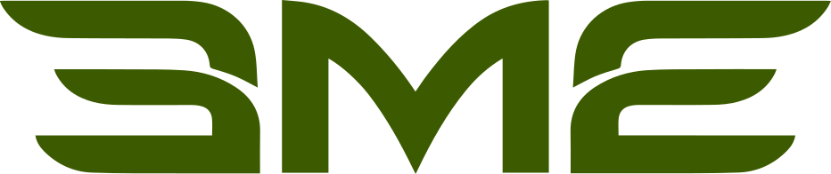
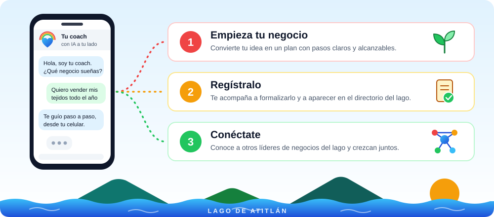

 

**Christopher Burkey** · Tel: +502 4611 8131 · [eme.world](https://eme.world)

# **Cumbre de Cocreación: capacitación gratuita para el Lago de Atitlán**

# **Solicitud de financiamiento (\$1,000 USD) para lanzar el programa en San Marcos La Laguna y comunidades aledañas**

# 

| Detalle del Proyecto | Información Institucional |
| :---- | :---- |
| **Programa** | Cumbre de Cocreación (incubadora y capacitación para emprendedores) |
| **Presentado por** | EME World Inc. (Fundación) |
| **Ubicación Base** | San Marcos La Laguna, Sololá, Guatemala |
| **Público Objetivo** | Toda persona que tenga un negocio en el Lago de Atitlán, local o extranjera. |
| **Objetivo** | Que cada emprendedor use su teléfono para trabajar, vender y crecer durante todo el año. |
| **Entidades Aliadas** | **LevelUp Guatemala** (donó el programa completo de cursos); **EME World Inc.** (presenta la propuesta); **UN Open Source Week** de la ONU (colaboración estratégica, ver sección 6) |

# **Tu coach de negocios personal, con IA**

**La Cumbre de Cocreación es un coach personal con inteligencia artificial, en tu teléfono.** Te acompaña paso a paso a **empezar** tu negocio, **registrarlo** y **conectarte** con otros líderes de negocios del Lago de Atitlán. Gratis, y a tu ritmo.

> **EME World** es una **Plataforma de Inteligencia Colectiva**: **IA personalizable para todos**. Una plataforma abierta, para cada necesidad de IA, con las personas siempre al mando.

# **Nuestra misión**

**Tecnología abierta para cocrear el futuro de cada comunidad.**

Creemos que la IA debe pertenecer a todos, no a unas pocas corporaciones. Por eso construimos, junto a la comunidad, una plataforma **abierta, gratuita y reutilizable**, inspirada en los principios de la **UN Open Source Week** de la ONU.

Y creemos que el cambio empieza escuchando: **escuchar** a las personas, **notar** lo que está emergiendo y **cocrear** juntos el siguiente paso, siempre con las **personas al mando** de la tecnología.

Nuestros valores: **Respeto por el tiempo**, **Más fuertes juntos**, **Ligeros con la Tierra** y **Abierto para todos**.

| Pantalla de inicio | Módulos de capacitación |
| :---: | :---: |
| |  |

# 

|  |
| :---- |

# **1\. ¿Qué es la Cumbre de Cocreación?**

La **Cumbre de Cocreación** es una aplicación móvil gratuita que enseña a los emprendedores del Lago de Atitlán a usar su teléfono para hacer crecer su negocio: organizarse, publicitarse, vender, cobrar en línea y tomar mejores decisiones.

No se trata de dar tecnología nueva: casi todos ya tienen un celular y lo usan todos los días. Se trata de **enseñarles a sacarle provecho a lo que ya tienen**.

## **De usuarios digitales a empresarios digitales**

Hoy, miles de emprendedores del lago usan WhatsApp, redes sociales y su teléfono para la vida diaria, pero pocos han tenido la oportunidad de aprender cómo esas mismas herramientas pueden ayudarlos a llegar a más clientes y crecer.

A través de talleres prácticos y progresivos, cada participante descubre cómo usar la tecnología para organizarse, visibilizarse, comunicarse y vender mejor. La idea central es simple: **"La tecnología no debe ser una barrera para emprender, sino un multiplicador del emprendedor."**

# **2\. El problema: cuando baja la temporada, baja todo**

Las comunidades del Lago de Atitlán viven al ritmo del turismo. En temporada alta hay trabajo; en temporada baja los ingresos caen y muchas familias no alcanzan a cubrir su alimentación. A esto se suma que la vivienda se ha vuelto inaccesible para buena parte de los habitantes, lo que presiona aún más a los hogares.

Mientras tanto, cada emprendedor sigue dependiendo de un solo cliente: el turista de temporada.

Para cambiar esta realidad no basta con esperar a que vuelva la temporada alta. Es necesario **capacitar a toda la comunidad para que pueda trabajar y vender todo el año**, usando su teléfono para ofrecer sus servicios, dar a conocer su negocio y llegar a clientes nuevos, dentro y fuera del lago.

## **Visión a Largo Plazo**

A largo plazo, la Cumbre de Cocreación aspira a que **empresas más grandes patrocinen programas de empleo, capacitaciones y eventos** en la región, creando un puente estable entre el talento local y las oportunidades de trabajo y de negocio.

# **3\. Lo que aprenden los participantes**

El programa combina habilidades clásicas de negocio con herramientas digitales, adaptadas a la realidad de la región:

* **Coach de Negocio:** Acompañamiento personalizado para que cada emprendedor descubra qué valores guían su negocio y tome decisiones alineadas con ellos.  
* **Contenido y Publicidad:** Un espacio para crear carteles, afiches y material comercial propio, sin depender de terceros ni pagar por publicidad.
* **Directorio de Negocios del Lago:** Un directorio donde cada persona registra su negocio y encuentra a otros emprendedores con quienes aliarse, trabajar juntos y crecer en equipo.

# **4\. El curso ya existe: LevelUp Guatemala lo donó**

No partimos de cero. La empresa guatemalteca **LevelUp** ha donado su programa completo de digitalización para emprendedores: cinco módulos que llevan a cada participante paso a paso, del uso básico del teléfono a la operación digital de su negocio.

**Metodología: aprender aplicando.** Los participantes no estudian teoría: aplican cada lección directamente a su propio negocio. Evalúan cómo operan hoy, identifican qué les falta, eligen las herramientas adecuadas y definen sus próximos pasos concretos. Al finalizar, cada emprendedor sabe qué puede hacer la tecnología por su negocio, por dónde empezar y cuál es su siguiente paso. Antes de actuar, cada persona aprende a **escuchar** con atención a su comunidad y a sus clientes, a notar lo que está emergiendo y a **cocrear** el siguiente paso junto a otros, avanzando hacia el futuro que se está abriendo.

# **5\. Lo que pedimos: \$1,000 USD**

Para lanzar la aplicación y ofrecer la capacitación **gratuita** a todos los habitantes de San Marcos La Laguna, solicitamos un fondo de arranque de \$1,000 USD. Este monto cubre:

* **Dos coordinadores locales:** Contratación de dos vecinos de San Marcos La Laguna que coordinarán las actividades, darán seguimiento a cada participante y garantizarán que la comunidad se sienta representada en el programa.  
* **Acceso abierto y universal:** Garantizar que la aplicación y los talleres estén disponibles para todos los emprendedores, jóvenes y vecinos de la comunidad, sin costo alguno.

## **¿Por qué financiar este programa?**

Dar acceso a la tecnología no basta; lo que hace falta es enseñar a usarla de manera productiva. Y el impacto se ve rápido:

* Para un emprendedor informal, organizar sus pedidos en el teléfono —en lugar de depender de la memoria— significa menos errores y más confianza del cliente.
* Para un micronegocio, aparecer en línea significa que lo pueden encontrar clientes que nunca pisan el lago.
* Para un negocio en crecimiento, cobrar en línea y ver sus ventas significa crecer con información, no a ciegas.

Estos primeros pasos son la base de empresas más sólidas, más productividad y acceso a nuevos mercados —y preparan a los participantes para dar los siguientes: automatización e Inteligencia Artificial.

# **6\. Quiénes estamos detrás**

**EME World Inc.** es una **Fundación** 501(c)(3) dedicada a la mejora comunitaria y al desarrollo de capacidades mediante tecnología abierta, **sin depender de grandes corporaciones**.

## **IA que pertenece a todos**

* **Chat gratuito para todos:** en móvil y web, con capacidad para miles de usuarios y servidores trabajando juntos. Cada persona cuenta con su gemelo digital EME, que se une a la conversación cuando hace falta.
* **Tokens ilimitados:** cada servidor EME corre en hardware dedicado, sin cargos por uso.
* **Las personas al mando:** quien usa la plataforma guía cada acción importante.
* **Servidores en todo el mundo:** trabajamos con la ONU, y entre nuestros clientes están Yale y la Canadian Broadcasting Corporation (CBC).
* **Comunidad:** cada mes, la Comunidad EME se reúne y envía sus comentarios a nuestra Oficina del Programa de Código Abierto (OSPO).

La aplicación de la Cumbre de Cocreación funciona sobre esta plataforma, como uno de los servidores EME de la comunidad. Actualmente, EME World Inc. impulsa iniciativas globales de recaudación de fondos y mantiene colaboraciones estratégicas en el marco de la UN Open Source Week, para poner la tecnología al servicio del empoderamiento de comunidades vulnerables y en desarrollo.

# **7\. Cómo funciona y próximos pasos**

Las actividades de la Cumbre de Cocreación son híbridas, para que nadie se quede fuera:

* **Reuniones semanales:** Todos los miércoles, presencialmente en San Marcos La Laguna y con conexión en vivo por Zoom.  
* **Fase actual:** Recopilación de notas, diseño de guiones instructivos e integración del catálogo formativo donado por LevelUp.

---

**Aprobaciones y Firma del Documento**

Para constancia de la presentación de esta propuesta y su sometimiento al periodo de validación comunitaria:

Representante de EME World Inc.: Christopher Burkey cburkey@eme.world

Coordinador Comunitario San Marcos La Laguna: Bracamonte de Leon growth@growtlan.com

Coordinador Level Up: Louis Prouvost <Louis@levelup.gt> www.levelup.gt

Fecha de Publicación para Consenso: Jan 1 2027
