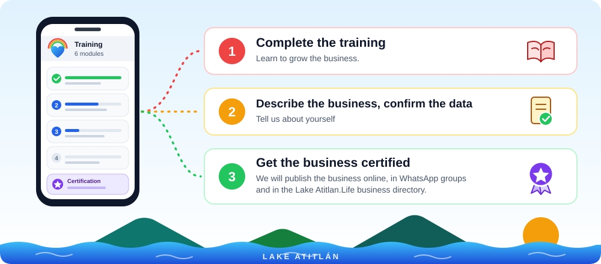
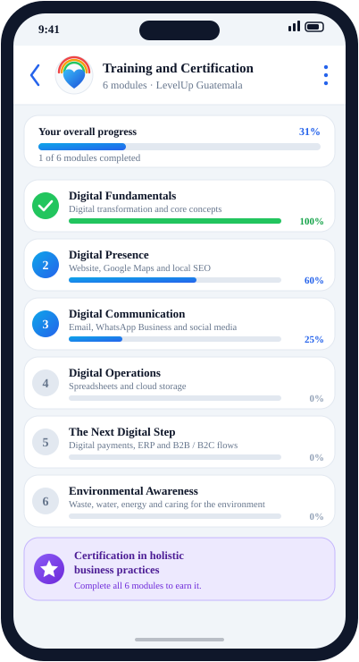

**Christopher Burkey** · Tel: +502 4611 8131 · [eme.world](https://eme.world)

# **Funding request (\$1,000 USD) to launch free business training to improve the economy of Lake Atitlán**

| Project Detail | Institutional Information |
| :---- | :---- |
| **Program** | Cumbre de Cocreación (free, self-guided training for entrepreneurs, on a mobile website) |
| **Presented by** | EME World Inc. |
| **Home Base** | San Marcos La Laguna, Sololá, Guatemala |
| **Target Audience** | Anyone who has a business or a concrete business idea at Lake Atitlán, local or foreign. |
| **Goal** | Improve business success and job creation on Lake Atitlán. |
| **Partner Organizations** | **LevelUp Guatemala** (donated the complete course program); **Impact Atitlán / Impacto Social Económico**; **EME World Inc.** (presents the proposal) |
| **Testing Scale** | Open enrollment. Planning target: about 60 people enrolled. |

# **1. About us**

Three partners bring this program to San Marcos La Laguna: the training, the technology and the community connection.

## **Our values**

Respect for time, Stronger together, Light on the Earth and Open to all.

## **LevelUp Guatemala**

LevelUp Guatemala donated the complete course program that participants follow on the website. It is the core of the training.

Contact: Louis Prouvost, Louis@levelup.gt, [www.levelup.gt](https://www.levelup.gt)

## **EME World Inc.**

EME World builds open technology that helps communities work together, without depending on large corporations. It presents this proposal, sets up and hosts the Cumbre de Cocreación website on a community EME server, and provides human technical support during testing.

Contact: Christopher Burkey, cburkey@eme.world, +502 4611 8131, [eme.world](https://eme.world)

## **Impact Atitlán / Impacto Social Económico**

Impact Atitlán is a local organization working for social and economic impact in San Marcos La Laguna. It connects the program with local business owners and the community, and serves as the community coordinator.

Contact: Bracamonte de Leon, growth@growtlan.com, [WhatsApp group](https://chat.whatsapp.com/Esdg1vw8vAw0LzgE7ioVEA)

---

# **2. What is Cumbre de Cocreación?**

**Cumbre de Cocreación** is a free mobile website that teaches entrepreneurs at Lake Atitlán to use technology to grow their business and get the most out of what they already have. Through practical, progressive lessons, each participant discovers how to use technology to get organized, become visible, communicate and sell better. 

In three steps, a business will **complete the training**, **describe the business and confirm its data**, and **get certified**. Then, we will publish the business online, in WhatsApp groups and in the Lake Atitlan.Life business directory.

# **3. Who can participate?**

Owners of micro and small businesses, formal and informal, independent workers and people developing a business idea in the Lake Atitlán area can participate. Tourism, lodging, food, retail, crafts and local services may be priority sectors, but they are **not a requirement**.

No digital experience is required, and the website runs on most computers and phones.

**We do not require formal education.** The modules will use simple language and visual examples. The program will be offered in **English and Guatemalan Spanish only**.

---

# **4. How it works**

**Self-guided, on a mobile website, no live sessions.** Participants move at their own pace through the training, about **32 hours** in total.

Users can ask questions in the tutorial, and the agent searches previously uploaded documentation to answer them.

The training is not fixed: we will **adjust it based on feedback from participants and the community**. We call this **adaptive learning**.

The tutorial is shared with a simple link that can be sent to any business by WhatsApp, email or social media. The link opens in any web browser, on a computer or a mobile phone, with nothing to install.

| Training modules (example) | Active lesson (example) |
| :---: | :---: |
|  |  |

---

# **5. What we are asking for: \$1,000 USD**

To launch the website and offer **free** training to the residents of San Marcos La Laguna and surrounding communities, we request seed funding of \$1,000 USD.

| Category | Amount | What it funds | Evidence |
| :---- | ----: | :---- | :---- |
| **Website setup** (regular price \$1,500, with 50% discount) | \$750 | Setup and configuration of the Cumbre de Cocreación website on a community EME server: LevelUp courses, chat, each person's progress and directory. Includes one year of hosting. | Invoice or receipt and list of what was delivered |
| **Human technical support** (testing phase, two months from launch) | \$250 | Help by WhatsApp to get started on the website and solve technical problems. | Log of consultations handled and receipt |
| **Total** | **\$1,000** | | |

**Regular price and discount.** The website setup costs \$1,500. EME World, which presents this proposal and also provides the service, offers this project a **50% discount**: \$750 is charged and the other \$750 is not charged. We state this so the funder can see the real price and the contribution.

**Hosting.** Hosting, maintenance and licenses are included for one year. After one year, the project can be renewed.

**Human technical support.** Human support by WhatsApp is available only during the testing phase, which lasts two months from launch. After that, participants continue on their own, and the tutorial agent answers questions from the uploaded documentation.

**What this budget does not cover:** hosting, maintenance and licenses after the first year, human technical support after the testing phase, development of new features, or transportation. We do not count any volunteering or donated service as confirmed, except the LevelUp content and the EME World discount. It also does not include local coordinators, paid advertising, extensive one-on-one coaching or live sessions; those would require additional resources.

---

# **6. Why fund this program?**

San Marcos La Laguna runs on its small businesses: cafés, hostels, guides, artisans, shops and services. When they succeed, the whole town succeeds. This program is a small, focused investment in that economy.

* **Your funding goes straight to local businesses.** The training is free for participants and the course content is donated, so every dollar goes to putting the program in owners' hands.
* **Stronger businesses create local jobs.** A business that is organized, visible and selling more can hire neighbors and buy from other local suppliers, so the money keeps circulating in San Marcos.
* **More visibility brings new customers to town.** Certified businesses are published online, in WhatsApp groups and in the Lake Atitlan.Life directory, so visitors and buyers can find them before they ever arrive at the lake.
* **The skills last after the money is spent.** Owners keep what they learn, and the website and tutorial agent stay available for a full year, so the impact keeps growing after testing ends.
* **You will see measurable results.** Enrollment, progress, certification and cost per graduate give a clear picture of the return and provide a proven model that can scale to other communities around the lake.

# **7. Timeline and next steps (provisional)**

Testing starts two weeks after payment. Weeks count from payment (week 0).

# **8. Confirmation schedule**

| Milestone | Date |
| :---- | :---- |
| **Published for consideration and comments** | November 24, 2026 |
| **Target decision date** | December 1, 2026 |
