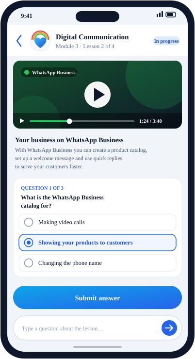
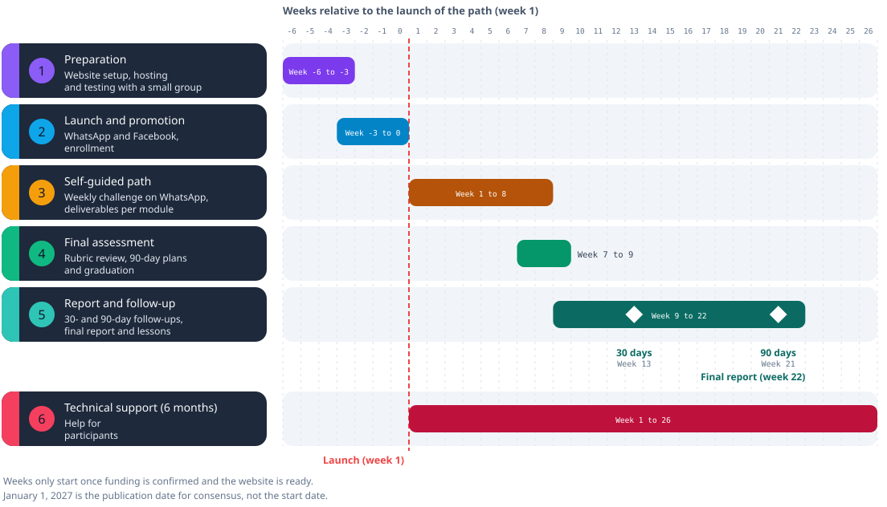

 

**Christopher Burkey** · Tel: +502 4611 8131 · [eme.world](https://eme.world)

# **Funding request (\$1,000 USD) to launch the program in San Marcos La Laguna and surrounding communities**

| Project Detail | Institutional Information |
| :---- | :---- |
| **Program** | Cumbre de Cocreación (free, self-guided training for entrepreneurs, on a mobile website) |
| **Presented by** | EME World Inc. |
| **Home Base** | San Marcos La Laguna, Sololá, Guatemala |
| **Target Audience** | Anyone who has a business or a concrete business idea at Lake Atitlán, local or foreign. |
| **Goal** | Improve business effectiveness and job creation on Lake Atitlán. |
| **Partner Organizations** | **LevelUp Guatemala** (donated the complete course program); **EME World Inc.** (presents the proposal) |
| **Pilot Scale** | Open enrollment. Planning target: about 60 people enrolled |

# **Three steps to improve business effectiveness and job creation on Lake Atitlán**

**Cumbre de Cocreación is a free mobile website for entrepreneurs.** In three steps, a business will **complete the training**, **describe the business and confirm its data**, and **get certified**. Then, we will publish the business online, in WhatsApp groups and in the Lake Atitlan.Life business directory. Free, and at the business owner's own pace.

# **Our mission**

**Open technology to co-create the future of every community.**

We believe AI should belong to everyone, not to a few corporations. That is why, together with the community, we build an **open, free and reusable** platform.

And we believe change starts with listening: **listen** to people, **notice** what is emerging and **co-create** the next step together, always with **people in charge** of the technology.

That is why the training is not fixed: we will **adjust it based on feedback from participants and the community**. We call this **adaptive learning**.

**What this proposal funds.** The pilot launches the course donated by LevelUp with a shareable link and EME providing technical support for the first 60 participants.

Our values: **Respect for time**, **Stronger together**, **Light on the Earth** and **Open to all**.

| Training modules (example) | Active lesson (example) |
| :---: | :---: |
|  |  |

---

# **1. What is Cumbre de Cocreación?**

**Cumbre de Cocreación** is a free mobile website that teaches entrepreneurs at Lake Atitlán to use technology to grow their business and get the most out of what they already have.

## **From digital users to digital entrepreneurs**

Through practical, progressive lessons, each participant discovers how to use technology to get organized, become visible, communicate and sell better. The central idea is simple: **"Technology should not be a barrier to entrepreneurship, but a multiplier for the entrepreneur."**

# **2. Who can participate?**

Owners of micro and small businesses, formal and informal, independent workers and people developing a business idea in the Lake Atitlán area can participate. Tourism, lodging, food, retail, crafts and local services may be priority sectors, but they are **not a requirement**.

No digital experience required and runs on most computers or phones.

**We do not require formal education.** The modules will use simple language and visual examples. The program will be offered in **English and Guatemalan Spanish only**.

# **3. How it works**

**Self-guided, on a mobile website, no live sessions.** Participants move at their own pace through the training, about **32 hours** in total **[to be confirmed with LevelUp]**. A suggested path of about 8 weeks, with a weekly challenge in a community WhatsApp group, helps keep momentum, and technical support by WhatsApp or call is available for the first 60 participants.

Participants who complete the training and confirm their business data are certified, and their business is published online, in WhatsApp groups and in the Lake Atitlan.Life business directory. We check in at 30 and 90 days, and the training is adjusted based on participant and community feedback.

**Launch and promotion.** WhatsApp groups, Facebook posts and QR-code posters, shared by EME World, the community and the businesses themselves. No paid advertising is budgeted.

# **4. What we are asking for: \$1,000 USD**

To launch the website and offer **free** training to the residents of San Marcos La Laguna and surrounding communities, we request seed funding of \$1,000 USD. **This is an initial scenario, not a confirmed budget.**

| Category | Amount | What it funds | Evidence |
| :---- | ----: | :---- | :---- |
| **Website setup** (regular price \$1,500, with 50% discount) | \$750 | Setup and configuration of the Cumbre de Cocreación website on a community EME server: LevelUp courses, chat, each person's progress and directory. **[To be confirmed]** exact scope | Invoice or receipt and list of what was delivered |
| **Technical support for the first 60 participants** | \$250 | Help by WhatsApp and call to open and use the website and WhatsApp, and to solve technical problems. **[To be defined]** hours and who provides it | Log of consultations handled and receipt |
| **Total** | **\$1,000** | | |

**Regular price and discount.** The website setup costs \$1,500. EME World, which presents this proposal and also provides the service, offers this project a **50% discount**: \$750 is charged and the other \$750 is not charged. We state this so the funder can see the real price and the contribution.

**What this budget does not cover:** hosting, maintenance and licenses for the website after the setup, development of new features, or transportation. Without a facilitator or live sessions, the website is the program, so **[to be confirmed]** in writing what the setup includes and who sustains hosting and maintenance. We do not count any volunteering or donated service as confirmed, except the LevelUp content and the EME World discount. It also does not include local coordinators, paid advertising, extensive one-on-one coaching or live sessions; those would require additional resources.

## **Why fund this program?**

Giving access to technology is not enough; what is needed is teaching people to use it productively. And the impact shows quickly:

* For an informal entrepreneur, organizing orders in a simple digital tool instead of relying on memory means fewer mistakes and more customer trust.
* For a micro-business, appearing online means customers who never set foot at the lake can find them.
* For a growing business, getting paid online and seeing their sales means growing with information, not blindly.

These first steps are the foundation of stronger businesses, more productivity and access to new markets, and prepare participants to take the next ones: automation and Artificial Intelligence.

# **5. Sustainability and next steps**

The pilot seeks to show that a low-cost, self-guided model, with donated content, community promotion and WhatsApp support, produces verifiable digital skills and tools in use. Its data (enrollment, progress, completion, cost per graduate) would be the basis for requesting more funding with evidence.

**Possible sources for a next stage** (to be explored, **none is committed**): sponsorship from local businesses and tourism-sector companies, corporate social responsibility, grants, partnerships with the municipality and with tourism and trade associations.

**Possible Phase 2 (future, no funding or operation today):** automated learning guidance and locally relevant digital tools, with people always in charge. It would be evaluated only after validating the pilot.

# **6. Main risks**

| Risk | How we handle it |
| :---- | :---- |
| **Low participation and dropout** (the main risk of the self-guided format) | Weekly challenge and WhatsApp reminders, short lessons, technical support for anyone who gets stuck, prudent targets |
| **Low digital literacy** | Visual examples, personal support by WhatsApp |
| **Weak or expensive internet** | Data packages, lightweight content |
| **The website is not ready or fails** | Test it with a small group before promoting it and launch only when it works |
| **Website costs after the setup** | Confirm in writing what the setup includes and who covers hosting and maintenance afterward |
| **Language and cultural barriers** | Simple language, visual examples, content in English and Guatemalan Spanish |

# **7. Who is behind this**

**EME World Inc.** is a 501(c)(3) nonprofit dedicated to community improvement and capacity building through open technology, **without depending on large corporations**. Every month, the EME Community meets and sends its feedback to our Open Source Program Office (OSPO).

EME World has worked with organizations such as Yale and the Canadian Broadcasting Corporation (CBC). **[To be documented]** the scope of each collaboration before citing it to a funder.

The Cumbre de Cocreación website runs on this platform, as one of the community's EME servers.

# **8. Timeline and next steps (provisional)**

The **publication date for consensus is January 1, 2027**. It is not the start date. Weeks are relative to the launch of the path (week 1).

**Current phase:** gathering notes, designing instructional scripts and integrating the training catalog donated by LevelUp. In high season entrepreneurs have less time; the self-guided format helps, and the launch date will be chosen with the community.

---

**Approvals and Document Signature**

As a record of the submission of this proposal and its submission to the community validation period:

EME World Inc. Representative: Christopher Burkey cburkey@eme.world

San Marcos La Laguna Community Coordinator: Bracamonte de Leon growth@growtlan.com

Level Up Coordinator: Louis Prouvost <Louis@levelup.gt> www.levelup.gt

Publication Date for Consensus: January 1, 2027
